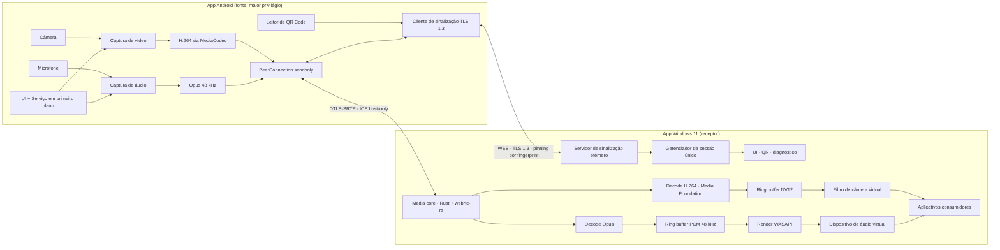
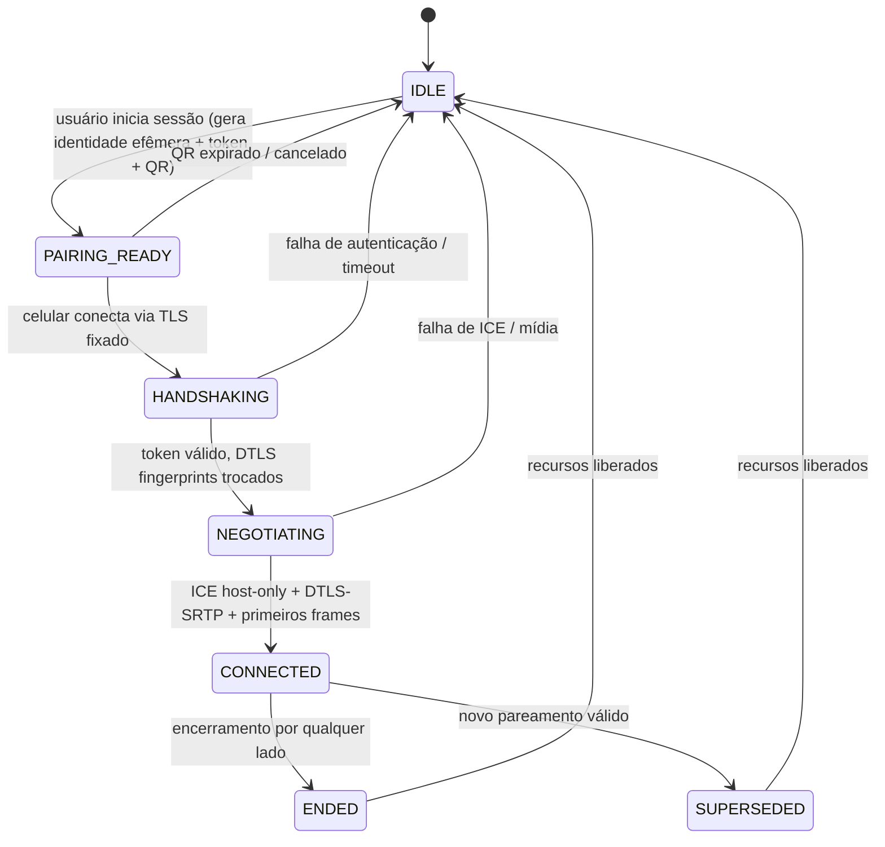

# TDD — RemoteCam V1: pareamento de câmera e microfone entre Android e Windows

| Campo | Valor |
| --- | --- |
| Produto | RemoteCam |
| Tech Lead | @TBD (bloqueador de aprovação) |
| Product Manager | @TBD |
| Equipe | Android @TBD · Windows/Native @TBD · Desktop App @TBD · QA @TBD |
| Épico / Ticket | @TBD (criar após aprovação) |
| Design / Figma | @TBD |
| Status | Draft — aguardando revisão técnica |
| Criado | 2026-10-22 |
| Última atualização | 2026-10-22 |
| Horizonte | V1 (Android + Windows 11), projeto grande (> 1 mês) |

---

## 1. Contexto

RemoteCam transforma um celular Android em câmera e microfone para um computador Windows 11, sem cabos e sem internet, usando apenas a rede local. O celular é a **fonte** de mídia e o **elemento de maior privilégio** da relação: ele inicia a sessão escaneando um QR Code exibido pelo computador, escolhe o que captura e pode encerrar a sessão a qualquer momento. O computador é um **receptor passivo**: publica câmera e microfone virtuais para que outros programas (videoconferência, gravadores, navegadores) os usem como se fossem dispositivos físicos.

O domínio é o de **captura de mídia em tempo real e dispositivos virtuais**. A restrição de rede local elimina a necessidade de infraestrutura de nuvem, mas transfere para o handshake e para a camada de transporte toda a responsabilidade de autenticação, confidencialidade e integridade. A restrição de plataforma (Windows 11 + Android) permite decisões que seriam inviáveis num escopo multiplataforma, em especial o uso de APIs de câmera virtual disponíveis apenas no Windows 11.

O projeto parte de um repositório vazio: não há código, esquema de dados ou infraestrutura preexistentes. Este documento define as decisões de arquitetura da V1 e os contratos entre os componentes; detalhes de implementação pertencem ao código e às tarefas derivadas.

**Stakeholders**: usuários finais (criadores de conteúdo, pessoas em reuniões, aulas e atendimentos), time de produto, time de segurança (revisão do handshake), suporte (instalação de drivers) e jurídico (licenciamento de drivers de terceiros).

---

## 2. Definição do problema e motivação

### 2.1 Problemas que estamos resolvendo

- **Câmera e microfone de baixa qualidade em reuniões e gravações no desktop.** Webcams dedicadas custam caro e ficam atrás da qualidade de um celular moderno; a alternativa atual é gravar no celular e transferir depois, o que quebra o fluxo ao vivo.
  - Impacto: qualidade percebida pior em calls, gravações refeitas, tempo perdido.
- **Ferramentas atuais exigem internet, conta ou nuvem.** As soluções populares roteiam mídia por servidores externos, com latência variável e exposição de dados pessoais.
  - Impacto: dependência de terceiros, risco de privacidade, uso inviável em redes restritas ou isoladas.
- **Pareamento confuso e persistente.** Aplicativos concorrentes mantêm pareamentos salvos, contas e dispositivos autorizados, criando superfície de ataque e estados difíceis de auditar.
  - Impacto: sessões "fantasma", dispositivos desconhecidos reconectando, dificuldade de explicar quem acessa o quê.
- **Risco de vazamento de áudio interno do celular.** Muitas soluções capturam toda a saída de áudio do aparelho (música, notificações, chamadas) e enviam ao computador, o que é um vazamento de privacidade inaceitável.
  - Impacto: exposição de conteúdo pessoal, violação de expectativa do usuário.

### 2.2 Por que agora

- **Técnico**: o Windows 11 consolidou APIs de câmera virtual que permitem publicar vídeo sem driver de kernel próprio; para áudio, a V1 depende de um dispositivo virtual de terceiro, decisão explícita que evita certificação de driver nesta fase.
- **De produto**: a demanda por vídeo de qualidade em trabalho remoto e criação de conteúdo é permanente, e o diferencial de "local-only, sem conta, sem estado" é verificável e comunicável.
- **De engenharia**: o custo de manter compatibilidade multiplataforma (iOS/macOS) seria desproporcional ao valor da V1; restringir o escopo permite entregar qualidade de transmissão antes de ampliar plataformas.

### 2.3 Impacto de não resolver

- **Negócio**: permanece a dependência de webcams físicas e de serviços em nuvem, sem produto próprio nesse espaço.
- **Técnico**: cada consumidor de mídia (Zoom, Teams, OBS, navegador) continua exigindo workarounds manuais e frágeis.
- **Usuários**: continuam expostos a ferramentas que armazenam pareamentos e capturam áudio de saída sem transparência.

---

## 3. Escopo

### 3.1 Em escopo (V1)

- App Android (Kotlin nativo) que captura **somente microfone** e **vídeo de câmera**, com seleção de câmera, torch e enquadramento.
- App Windows 11 (x64) que recebe a mídia e publica:
  - um dispositivo de **câmera virtual** visível para aplicativos do sistema;
  - um dispositivo de **microfone virtual** visível para aplicativos do sistema.
- Pareamento por **QR Code novo a cada sessão**, com handshake autenticado e criptografado (TLS 1.3 + DTLS-SRTP).
- Sessão **um-para-um**, com substituição determinística: um novo pareamento invalida a sessão anterior, nos dois sentidos.
- Descoberta e conexão restritas à **rede local** (mesma sub-rede, endereços privados), sem STUN/TURN, sem servidor externo.
- Detecção, verificação e orientação de instalação dos drivers de dispositivo virtual suportados.
- Diagnóstico local (painel de métricas), sem telemetria em nuvem.
- Empacotamento, assinatura de código e atualização dos dois apps.

### 3.2 Fora de escopo (V1)

- Transmissão do computador para o celular (qualquer mídia, tela, arquivo, clipboard ou áudio).
- Áudio de saída do celular (música, vídeos, notificações, chamadas) para o computador.
- iOS, macOS, Windows 10, Linux e qualquer plataforma além de Android + Windows 11 x64.
- Gravação de tela, gravação de sessão ou armazenamento de mídia.
- Conexão pela internet, VPN, NAT traversal, relay ou nuvem.
- Múltiplos celulares simultâneos, múltiplos desktops pareados, contas de usuário, histórico de dispositivos.
- Controle remoto do celular pelo desktop (iniciar/parar captura, trocar câmera, torch, zoom).
- Driver de kernel próprio de câmera ou áudio.

### 3.3 Considerações futuras (V2+)

- Driver próprio assinado, eliminando dependência de drivers de terceiros.
- Suporte a Windows 10 e/ou macOS/Linux.
- Áudio estéreo e processamento de voz (supressão de ruído) configurável.
- Múltiplas sessões simultâneas com seleção de fonte por aplicativo.
- Empacotamento na Microsoft Store / Play Store com atualização gerenciada.

---

## 4. Critérios de aceite e verificação

| # | Critério de aceite | Como será verificado |
| --- | --- | --- |
| A1 | Conexão segura computador ↔ celular | Testes de handshake: pinning exato de certificado, token de uso único, rejeição de replay/expirado, DTLS-SRTP obrigatório, ausência de tráfego em claro. |
| A2 | Leitura de QR Code funcional para cada nova sessão | Sessão nova sempre gera QR novo (token e identidade efêmeros); QR antigo é rejeitado; nenhum pareamento é reaproveitado após reinício. |
| A3 | Câmera virtual funcional a partir da transmissão do celular | Aplicativo de teste enumera o dispositivo, recebe frames e valida resolução/fps por 30 min contínuos. |
| A4 | Microfone virtual funcional a partir da transmissão do celular | Aplicativo de teste grava do dispositivo virtual e valida áudio inteligível, continuidade e ausência de silêncio intermitente. |
| A5 | Conexão em rede local | Sessão funciona com internet desabilitada no roteador; candidatos ICE e endereços fora de faixas privadas são rejeitados. |
| A6 | Áudio interno do celular nunca enviado | Revisão de permissões/APIs + teste automatizado de tráfego + manifesto sem APIs de captura de reprodução. |
| A7 | Nada do computador enviado ao celular | Teste que contabiliza pacotes RTP de mídia do desktop (deve ser zero; RTCP permitido) e valida allowlist de mensagens de sinalização. |
| A8 | Sessão substituída por novo pareamento | Teste de concorrência: novo pareamento derruba o anterior em ambos os lados, sem sobreposição de mídia. |

---

## 5. Solução técnica

### 5.1 Visão geral e componentes

A arquitetura separa **sinalização** (canal de controle autenticado por QR) de **mídia** (WebRTC, DTLS-SRTP, somente celular → desktop). O desktop nunca cria trilhas de envio; o celular nunca captura áudio de reprodução.



**Componentes e responsabilidades**

| Componente | Responsabilidade | Onde roda |
| --- | --- | --- |
| App Android | Permissões, captura, encode, transporte, QR, UI, ciclo de vida em primeiro plano | Android 10+ (minSdk 29, targetSdk 36) |
| Servidor de sinalização | Escuta TLS local, valida token/QR, negocia SDP/ICE, aplica substituição de sessão | Windows |
| Media core | PeerConnection receive-only, jitter buffer, decode, sincronização, métricas | Windows (Rust; também compila no Linux para testes) |
| Ponte de vídeo | Publicação de NV12 em buffer compartilhado, com produtor em Rust | Windows |
| Câmera virtual | Media source MF (`MFCreateVirtualCamera`) que expõe os frames aos aplicativos; filtro DirectShow apenas como fallback | Windows |
| Ponte de áudio | Render PCM no dispositivo virtual de áudio | Windows |
| App Windows (shell) | UI, QR, instalação/verificação de drivers, diagnóstico, bandeja, firewall, updates | Windows (Rust + Slint) |
| Protocolo (especificação) | Contrato versionado de mensagens, estados e regras de validação, com implementações em Kotlin e Rust | Ambos |
| Harness de teste | Dois endpoints headless, mídia sintética, asserções de invariantes | Linux (CI) |

**Por que Rust no desktop**

Rust foi escolhido para o app Windows: binário único, sem runtime gerenciado, segurança de memória e interoperabilidade direta com COM/Win32 pela crate `windows`. O custo dessa escolha é que o pipeline de recepção não vem pronto: `webrtc` (webrtc-rs) entrega ICE, DTLS, SRTP, RTP/RTCP, NACK/PLI e depacketização, mas **não** fornece jitter buffer/NetEq nem decoders. Jitter buffer, decode, sincronização e injeção são implementados no projeto, com Media Foundation para H.264 em hardware e libopus para áudio. Esse custo é tratado como risco com gate no spike F0 e fallback para GStreamer (`gstreamer-rs`) ou bindings de libwebrtc, mantendo a aplicação em Rust.

**Stack decidida**

| Camada | Decisão | Racional |
| --- | --- | --- |
| Android | Kotlin nativo, CameraX, libwebrtc Android SDK, ZXing embarcado | Controle de câmera/encoder, captura de baixa latência, leitor offline sem dependência de Google Play Services |
| Desktop (linguagem) | Rust (edition 2024) em todo o app, incluindo mídia, sinalização e UI | Binário único sem runtime gerenciado, segurança de memória, bom suporte a COM/Win32 pela crate `windows` e desenvolvimento no Linux |
| UI Windows | Slint | Nativo e leve, sem WebView, com desenvolvimento e depuração no Linux; alternativa de UI web via Tauri se o design exigir |
| Media core Windows | Rust + `webrtc` (webrtc-rs) + Media Foundation (decode H.264) + libopus | Transporte ICE/DTLS/SRTP/RTP/RTCP em Rust puro; decode por hardware entrega NV12; jitter buffer e sincronização são implementados por nós |
| Injeção de vídeo | Produtor em Rust + media source de câmera virtual do Windows 11 (fallback: filtro DirectShow) por memória compartilhada | Não exige driver de kernel; toda a lógica e o produtor ficam em Rust; o filtro DirectShow é fallback de dispositivo |
| Injeção de áudio | WASAPI (crate `windows`) renderizando para dispositivo virtual instalado pelo usuário | Único caminho viável sem driver de kernel próprio; funciona com qualquer dispositivo virtual compatível |
| Transporte | WebRTC (DTLS-SRTP), H.264 (preferido) / VP8, Opus | Baixa latência, criptografia obrigatória, NACK/PLI; jitter buffer próprio por ser receptor-only |
| Sinalização | WebSocket sobre TLS 1.3 (tokio + rustls) com certificado efêmero (rcgen) fixado pelo QR | Canal autenticado, sem PKI externa, sem estado, com verificação de certificado customizada |
| QR | ZXing embarcado (Android) + geração com crate `qrcode` (Windows); payload binário compacto versionado | Offline, determinístico, tamanho de QR adequado à leitura à distância |

### 5.2 Modelo de confiança e privilégios

O celular é o **dono da sessão**. O desktop é **hospedeiro passivo**.

| Capacidade | Celular | Desktop |
| --- | --- | --- |
| Iniciar pareamento | Sim (escaneando QR) | Não (apenas exibe QR) |
| Encerrar sessão | Sim, a qualquer momento | Sim, encerrando o próprio listener |
| Definir o que é capturado | Sim | Não |
| Iniciar/parar câmera, trocar lente, torch, zoom | Sim | Não |
| Solicitar limites de resolução/fps/bitrate | — | Pode solicitar; o celular decide e pode recusar |
| Enviar mídia | Sim (áudio de microfone + vídeo) | **Nunca** |
| Receber mídia | **Nunca** | Sim |
| Alterar direção de trilhas | Sim (offer) | Não (answer recvonly) |
| Acessar arquivos, tela, clipboard, sensores do outro lado | Não | Não |

Regras invioláveis e como são garantidas:

| # | Invariante | Garantia de projeto | Verificação |
| --- | --- | --- | --- |
| I1 | Áudio interno do celular nunca é transmitido | Captura exclusivamente pelo caminho de microfone; app não declara nem solicita captura de reprodução (`MediaProjection`, `AudioPlaybackCapture`, `REMOTE_SUBMIX`); uma única trilha de áudio, sempre `sendonly` | Checagem estática no CI + manifesto + inspeção de tráfego + teste de API |
| I2 | Nada do desktop é enviado ao celular | Allowlist fechada de mensagens de controle; nenhuma trilha de envio é criada no desktop; SDP `recvonly` obrigatório; contador de RTP **de mídia** de saída deve ser zero (RTCP de controle, como relatórios e NACK, é permitido) | Teste de contrato + contador em runtime + asserção no harness |
| I3 | Toda sessão é nova, sem estado | Identidade efêmera, token de uso único, sem persistência de sessão, sem retomada, sem tickets TLS reutilizáveis | Inspeção de armazenamento antes/depois + testes de replay |
| I4 | No máximo uma sessão ativa; novo pareamento substitui | Máquina de estados com epoch monotônico; aceitação atômica de um único peer; encerramento terminal do anterior | Teste de concorrência com dois celulares |
| I5 | Celular tem privilégio | Nenhum comando de controle de captura é aceito pelo celular; limites do desktop são apenas "pedidos" | Teste de fuzzing de mensagens do desktop |

**Observação sobre cancelamento de eco**: como o celular não recebe áudio do desktop, não existe referência de reprodução para AEC. Eco acústico (som da caixa do computador entrando no microfone do celular) é um fenômeno físico, não um vazamento, e será tratado por orientação de uso (headset/posicionamento) e não por captura de áudio interno.

### 5.3 Sessão e handshake por QR Code

**Ciclo de vida**



Timeouts: QR válido por 120 s; handshake em até 15 s; ICE em até 10 s; primeiros frames em até 3 s. Qualquer timeout leva a `IDLE` com motivo exibido ao usuário. Não existe reconexão automática: nova sessão exige novo QR e novo scan.

**Payload do QR** (contrato, codificado em binário compacto e versionado; limite de 512 bytes para manter leitura confiável)

| Campo | Tamanho | Descrição |
| --- | --- | --- |
| `magic` | 4 B | Identificador do produto/protocolo |
| `version` | 1 B | Versão do payload (V1 = 1); versões desconhecidas são rejeitadas |
| `sessionId` | 16 B | Identificador aleatório da sessão |
| `epoch` | 4 B | Geração da sessão, atribuída pelo desktop no momento em que o QR é criado (monotônica e sempre maior que a da sessão ativa) |
| `endpoints` | variável | Lista de IPs privados + porta efêmera do listener TLS |
| `tlsFingerprint` | 32 B | SHA-256 do certificado TLS efêmero do desktop |
| `pairingToken` | 32 B | Token de uso único, comparado em tempo constante |
| `expiresAt` | 8 B | Expiração absoluta (epoch seconds) |
| `capabilities` | 2 B | Codecs e limites suportados (bitmask) |

Regras: o QR é **exibido apenas enquanto a sessão está em `PAIRING_READY`**; é regenerado a cada sessão; não é registrado em log, arquivo, clipboard ou histórico; ao escanear, o celular valida magic/versão/expiração antes de abrir conexão.

**Sequência do handshake**

```mermaid
sequenceDiagram
    autonumber
    participant U as Usuário
    participant D as Desktop
    participant M as Celular

    U->>D: Inicia sessão
    D->>D: Gera chave ECDSA P-256 efêmera + certificado de sessão
    D->>D: Gera token 256 bits + sessionId + epoch
    D->>D: Abre listener TLS 1.3 somente em interfaces privadas
    D-->>U: Exibe QR (endpoints, fingerprint, token, expiração)
    U->>M: Escaneia QR
    M->>M: Valida payload, expiração e versão
    M->>D: TLS 1.3 com verificação exata do fingerprint (sem CA)
    M->>D: pair { token, fingerprintDTLS do celular, limites desejados }
    D->>D: Valida token (uso único, tempo constante, rate limit)
    D->>M: paired { sessionId, epoch, fingerprintDTLS do desktop }
    M->>D: offer (áudio e vídeo sendonly)
    D->>M: answer (recvonly, sem trilhas de envio)
    Note over M,D: ICE host-only, sem STUN/TURN; DTLS-SRTP
    M-->>D: RTP vídeo (H.264) + áudio (Opus)
    D->>D: Decodifica, sincroniza e injeta nos dispositivos virtuais
    D->>M: close { superseded } (se outro pareamento ocorrer)
```

**Autenticação e sigilo**

- Certificado TLS **efêmero**, gerado em memória a cada sessão, validade restrita à sessão, chave privada nunca persistida.
- Pinning **exato** do fingerprint SHA-256 do certificado do desktop; falha de pinning aborta a conexão sem tentativa de fallback.
- O token de 256 bits é a prova de que quem conecta viu o QR; ele autentica o celular perante o desktop. A autenticação do desktop perante o celular vem do pinning.
- Fingerprints DTLS são trocados **dentro** do canal TLS autenticado; assim o DTLS-SRTP herda a autenticação da sinalização e um MITM na LAN não consegue se inserir.
- TLS 1.3 apenas, ALPN dedicado, retomada de sessão desabilitada, sem cookies, sem cache de credenciais.
- Comparação de token em tempo constante, uso único, limite de 5 tentativas por minuto por origem, bloqueio progressivo e encerramento do listener após 10 falhas consecutivas.
- Rejeição de conexões cujo IP de origem não seja privado (RFC 1918 / link-local) e que não pertença à mesma sub-rede do endpoint anunciado.

> **Emenda F0 (finding 12 — D-32).** O limite de 5 tentativas por minuto, o bloqueio
> progressivo e o encerramento do listener após 10 falhas consecutivas são **evidência
> medida**, não configuração: o gate de pairing registra cada decisão com código de
> motivo, prova que a tentativa 6 é recusada, que o listener fecha e que uma segunda
> origem legítima não é afetada. Um limite global seria um defeito de negação de
> serviço, não um controle.

**Substituição de sessão (last pairing wins)**

| Cenário | Comportamento |
| --- | --- |
| Celular A conectado; usuário escaneia QR de outro desktop | App A encerra a sessão local imediatamente (para captura, fecha transporte) e inicia a nova sessão. Não há confirmação bloqueante. |
| Celular B escaneia um QR válido do desktop que já atende A | Desktop valida o token, confirma que o `epoch` do novo QR é maior que o da sessão ativa, envia `close { superseded }` a A, destrói o estado de A e só então conclui o pareamento de B. Sobreposição de mídia é proibida. |
| Replay do mesmo QR | Rejeitado (token de uso único + expiração). Com sessão ativa, o código é `superseded`; sem sessão ativa, `token_already_used` (ADR-0013). Primeiro frame que não reapresenta token consumido, com sessão ativa e sem QR pendente: `protocol_violation`, sessão inalterada. |
| Mensagem com `epoch` inferior ao atual | Descartada silenciosamente e contabilizada como violação de protocolo. |
| Duas conexões simultâneas | A segunda só é aceita após o encerramento da primeira; o listener serializa as tentativas. |

O desktop sinaliza visual e sonoramente toda substituição ("Sessão assumida por outro celular"), porque a substituição automática é um requisito e também um vetor de sequestro por foto do QR. As mitigações são TTL curto, token de uso único, exigência de rede local e visibilidade do evento. Um ajuste opcional "exigir confirmação para substituir" pode ser oferecido no futuro, com padrão desligado para respeitar o requisito.

### 5.4 Captura no Android

- **Câmera**: CameraX como abstração de ciclo de vida, seleção de lente, preview, foco/zoom/torch. Os frames são entregues ao pipeline WebRTC por um capturer próprio alimentado pela análise de imagem em YUV, convertidos para I420. Essa escolha mantém um único dono da câmera e evita conflito com o capturer nativo. Um spike inicial mede o custo da conversão; se estourar o orçamento de latência, o plano B é o capturer Camera2 nativo do WebRTC, mantendo CameraX apenas para enumeração e preview.
- **Vídeo**: 1280×720 a 30 fps por padrão; 1920×1080 a 30 fps como máximo; H.264 com aceleração por hardware, VP8 como fallback. Perfil de baixa latência, sem B-frames, keyframe a cada 2 s.
- **Rotação e espelhamento**: rotação do sensor enviada nos metadados; o desktop aplica a rotação antes de publicar. Espelhamento existe apenas no preview local; a câmera virtual entrega a imagem não espelhada.
- **Áudio**: captura exclusivamente de microfone, 48 kHz, mono, Opus 32 kbps com FEC; sem DTX (evita cortes em apps que consomem o microfone virtual). Sem processamento de reprodução. O app não solicita permissão de gravação de tela.
- **Resiliência**: serviço em primeiro plano tipado como câmera e microfone, notificação persistente com botão "Encerrar", wake lock parcial, Wi-Fi lock de alto desempenho, opção "manter tela ligada". Em status térmico severo, redução automática de fps/resolução com aviso.
- **Privacidade visível**: indicadores de câmera/microfone do Android permanecem visíveis; ao perder a sessão, a captura para imediatamente e a notificação muda para estado encerrado.
- **Rede**: exige Wi-Fi em sub-rede privada; recusa iniciar pareamento em rede móvel. Não usa localização (o QR já contém o endereço).
- **API do libwebrtc**: a API Java mudou materialmente; `CapturerObserver` é top-level com três métodos e `OfferToReceive*` não existe mais. A implementação de F2 usa a API atual, não tutoriais antigos (D-17).

> **Emenda F0 (finding 8 — D-17).** O capturer próprio e o `PeerConnection` do app
> Android são escritos contra a API Java atual do libwebrtc; a nota acima é
> obrigatória na revisão do código de F2.

### 5.5 Transporte de mídia

| Aspecto | Decisão |
| --- | --- |
| Protocolo | WebRTC com DTLS-SRTP obrigatório; ICE com apenas candidatos `host` |
| Codecs | Vídeo: H.264 (preferido) → VP8 (fallback); Áudio: Opus 48 kHz mono |
| Direção | Celular `sendonly` em áudio e vídeo; desktop `recvonly`; desktop não cria transceptores |
| Bitrate | Vídeo 1,5–6 Mbps adaptativo (alvo 2,5 Mbps em 720p30); áudio 32 kbps |
| STUN/TURN | Desabilitados por construção; candidatos `srflx`/`relay` são rejeitados |
| Faixas de endereço | Apenas IPv4 privado e IPv6 link-local/ULA; qualquer outro destino aborta a sessão |
| Criptografia | DTLS 1.2+ com SRTP AES-GCM; fingerprints autenticados pela sinalização |
| Perda/jitter | Jitter buffer adaptativo próprio sobre RTP (webrtc-rs não oferece NetEq); NACK/PLI habilitados; sem retransmissão de áudio |
| Reconexão | Inexistente; queda encerra a sessão e exige novo QR |

**Contrato de sinalização (allowlist fechada)**

| Mensagem | Direção | Conteúdo | Validação no receptor |
| --- | --- | --- | --- |
| `pair` | Celular → Desktop | token, fingerprint DTLS do celular, limites desejados, versão | token uso único/expiração/tempo constante; versão suportada |
| `paired` | Desktop → Celular | sessionId, epoch, fingerprint DTLS do desktop, limites aceitos | pinning já validado; epoch monotônico |
| `offer` | Celular → Desktop | SDP com trilhas `sendonly` | apenas áudio/vídeo; sem data channels; sem `sendrecv` |
| `answer` | Desktop → Celular | SDP `recvonly` | celular rejeita qualquer trilha de envio ou direção `sendrecv` |
| `ice` | Ambos | candidato host | rejeita `srflx`/`relay` e IP não privado |
| `stats` | Celular → Desktop | métricas do cliente | opcional, sem identificadores |
| `close` | Ambos | código de motivo | motivo na enumeração fechada |
| `error` | Desktop → Celular | código + mensagem genérica | nunca inclui dados do host, caminhos, nomes de usuário ou IPs públicos |
| `ping`/`pong` | Ambos | keepalive | intervalo de 5 s; ausência por 15 s encerra |

Mensagens de sinalização são JSON com schema estrito (campos desconhecidos rejeitados), limite de tamanho por mensagem e sem dados binários de mídia. O SDP trafega como texto dentro desse envelope. O contrato é versionado e implementado de forma independente em Kotlin e Rust, com os mesmos testes de conformidade no harness.

A interoperabilidade H.264 entre o SDK Android (libwebrtc) e o webrtc-rs (perfil/fmtp negociado) é um gate do spike F0; se houver incompatibilidade, a V1 usa VP8 sem alterar a arquitetura, aceitando maior uso de CPU.

> **Emenda F0 (finding 11 — D-30).** O único perfil de perda/jitter válido para gate é
> **3 % de perda uniforme, 30 ms de latência adicional e ±10 ms de jitter, apenas
> mídia**. Qualquer desvio é rotulado como fora do perfil e não pode passar em gate;
> perda em rajada é julgada por dropouts detectados, nunca pela média de perda.

Códigos de encerramento: `ended_by_mobile`, `ended_by_desktop`, `superseded`, `timeout`, `media_failure`, `security_violation`, `internal_error`. Nenhuma mensagem do desktop carrega mídia, caminho de arquivo, nome de dispositivo, tela, clipboard ou informação do sistema além de códigos genéricos.

### 5.6 Injeção no Windows

#### Vídeo — câmera virtual

- **Base**: media source de câmera virtual do Windows 11 (`MFCreateVirtualCamera` com `MFVirtualCameraAccess_CurrentUser`, hospedado pelo Frame Server), com o produtor de frames em Rust. Não há driver de kernel; a instalação é por usuário via **MSI** (ver §5.10). O filtro DirectShow de `desktop/vendor/dshow-vcam-fallback/` passa a **fallback**, construído apenas quando uma célula da matriz falhar; a reescrita completa em Rust via COM fica para a V2.
- **Backends de decode**: Media Foundation (H.264 por hardware, saída NV12, padrão no Windows) e OpenH264 (software, usado no Linux/CI e como fallback). O backend é selecionável e reportado no diagnóstico. `MFT_ENUM_FLAG_HARDWARE` não é confiável: a descoberta usa `MFT_ENUM_FLAG_SYNCMFT | MFT_ENUM_FLAG_SORTANDFILTER` e a capacidade de hardware é verificada empiricamente (NV12) antes de qualquer medição (PC-1, D-05). O acesso ao buffer segue `IMF2DBuffer2::Lock2DSize`; o caminho GPU é `IMFGetService(MR_BUFFER_SERVICE)` → `IMFDXGIBackBuffer` → `ID3D11Texture2D` — `IMFHardwareBuffer` não existe.
- **Publicação de frames**: o decode entrega NV12 (MF) ou I420 convertido para NV12 (OpenH264); o produtor Rust escreve em um ring buffer de 3 buffers com cabeçalho (largura, altura, stride, formato, timestamp, contador de sequência). O media source (ou o filtro de fallback) lê o buffer mais recente; descarte do mais antigo em caso de atraso, nunca bloqueio da thread de rede.
- **Modos anunciados**: 640×480@30, 1280×720@30, 1920×1080@30. O aplicativo consumidor escolhe; o buffer é reescalado apenas se necessário e o frame é repetido para completar a taxa solicitada.
- **Registro**: por usuário (sem exigir administrador), com opção por máquina. A validação de que o registro por usuário é visível para apps de 32/64 bits é um gate do spike.
- **Compatibilidade**: matriz mínima de aplicativos consumidores (navegador Chromium, cliente de videoconferência, OBS, app de câmera do Windows, gravador). O backend primário é o media source do Windows 11; se algum consumidor relevante não enxergar a câmera, o fallback é o filtro DirectShow de `desktop/vendor/dshow-vcam-fallback/`, construído apenas para essa célula. A escolha é transparente para o usuário e verificável no diagnóstico.

> **Emenda F0 (findings 1, 4 e 5 — D-10, D-05).** O backend primário mudou de filtro
> DirectShow para `MFCreateVirtualCamera`; o filtro é fallback. `IMFHardwareBuffer` não
> existe: o acesso é `IMF2DBuffer2` e o caminho GPU é `IMFGetService(MR_BUFFER_SERVICE)`
> → `IMFDXGIBackBuffer`. `MFT_ENUM_FLAG_HARDWARE` não é confiável, então a capacidade de
> hardware é verificada empiricamente (NV12) antes de qualquer medição.

#### Áudio — microfone virtual

- O media core decodifica Opus para PCM 16 bits 48 kHz e renderiza continuamente via WASAPI no endpoint de reprodução do dispositivo virtual instalado (ex.: "CABLE Input"); os aplicativos capturam do endpoint de gravação correspondente ("CABLE Output").
- Mono é duplicado para estéreo quando o dispositivo exige; silence é renderizado quando o microfone está mudo ou a rede oscila — o stream nunca é interrompido, evitando renegociação nos apps consumidores.
- Buffer de 20–40 ms; correção de deriva por ajuste fino de taxa (reamostragem adaptativa) para manter o consumo estável ao longo de horas.
- O renderer é **paceado pelos timestamps RTP**; a reamostragem adaptativa corrige deriva, mas não substitui o pacing. O resampler sozinho coloca FR-014 em risco (D-24).
- Detecção do dispositivo por nome/características, verificação de assinatura do driver e teste de tom audível antes de liberar a sessão ("testar microfone virtual").

> **Emenda F0 (finding 6 — D-24).** O pacing vem dos timestamps RTP; o resampler é
> apenas correção de deriva.

#### Dependências de driver e experiência de instalação

| Dispositivo | V1 | Verificação | Se ausente |
| --- | --- | --- | --- |
| Câmera virtual | Media source MF próprio, user-mode, instalado por usuário via **MSI** | Enumeração + frame de teste | Instalação do MSI no setup (por usuário) |
| Microfone virtual | **VB-CABLE** (link-only), instalado pelo usuário; o app não redistribui o driver | Enumeração dos endpoints + verificação de assinatura + teste de tom | Wizard com link oficial e modo **somente vídeo** |

O app **não redistribui** driver de áudio de terceiros. A V1 detecta, verifica a assinatura e orienta a instalação pelo site oficial da VB-Audio. O modo "somente vídeo" é o **plano B aprovado** e permanece funcional se o driver de áudio não estiver disponível, com aviso claro (D-audio-licensing).

### 5.7 Sincronização, latência e qualidade

Orçamento de latência (p95, rede local 5 GHz sem congestionamento):

| Etapa | Orçamento |
| --- | --- |
| Exposição + captura (30 fps) | 33 ms |
| Encode H.264 por hardware | 15 ms |
| Rede + jitter buffer | 20 ms |
| Decode | 12 ms |
| Conversão + buffer compartilhado | 3 ms |
| Filtro/consumidor | 17 ms |
| **Total vídeo (vidro a vidro)** | **≈ 100 ms (meta ≤ 150 ms)** |
| **Áudio (microfone → dispositivo virtual)** | **≤ 120 ms — meta de F2/F3, não gate de F0** |

> **Emenda F0 (finding 7 — D-20, D-29).** O gate de latência julga o **p95 bruto
> captura-até-consumidor**; o harness floor medido e o valor corrigido pelo floor são
> publicados ao lado, nunca no lugar do bruto. Uma falha causada pelo procedimento de
> captura é distinguida de uma regressão do produto na atribuição de latência.

> **Emenda F0 (finding 10 — D-31).** A meta de ≤ 120 ms de áudio não é gateável em F0:
> ela exige o caminho real de captura do celular e é carregada para F2/F3 como meta de
> produto. F0 mede latência de vídeo apenas.

Sincronização: timestamps RTP (clock comum) guiam a apresentação; áudio é o relógio mestre do desktop. Deriva-alvo de até 20 ms entre áudio e vídeo ao longo de 1 h; 100 ms é o limite rígido que encerra a sessão com `media_failure`. Áudio e vídeo nunca são misturados em um único buffer.

Adaptação: controle de bitrate por perda/RTT; redução de resolução antes de reduzir fps; pausa de vídeo (frame congelado é proibido — o filtro passa a repetir o último frame apenas por até 2 s) quando não há frames, com aviso na UI.

### 5.8 Dados e estado

- **Nenhum estado de sessão é persistido** em nenhum dos lados: sem banco, sem arquivo, sem preferências de pareamento, sem Keystore, sem registro de dispositivo, sem histórico, sem retomada.
- Chaves privadas, tokens e fingerprints vivem apenas em memória e são destruídos ao encerrar a sessão.
- O desktop grava no registro apenas o necessário para o **registro COM do dispositivo virtual** (artefato de instalação, não de sessão).
- A prova de ausência de resíduo cobre **dois casos com o mesmo método**: depois do encerramento normal da sessão e depois do reinício do aplicativo. O segundo caso é onde um bug de persistência se esconde (D-33).

> **Emenda F0 (finding 13 — D-33).** Provar ausência de resíduo só depois do fim normal
> não prova nada sobre o reinício. As duas inspeções usam o mesmo método e o relatório
> declara o que foi varrido em cada uma.
- Preferências puramente visuais (ex.: resolução preferida, manter tela ligada) podem existir, mas não contêm identificadores, IPs ou histórico de conexões.
- Diagnóstico é local e opcional: métricas agregadas, sem conteúdo de mídia, com retenção de 24 h e exportação manual. Nenhum dado sai do dispositivo.

### 5.9 Fluxos de usuário

**Desktop**

1. Abrir o app → painel com estado dos dispositivos virtuais (pronto, ausente, precisa de instalação).
2. "Iniciar sessão" → QR grande, contador de expiração, instruções ("escaneie com o app RemoteCam").
3. Celular pareia → tela de sessão com preview, resolução/fps, latência, botão "Encerrar".
4. Novo pareamento durante sessão → aviso de substituição + sessão anterior encerrada.
5. Diagnóstico acessível na bandeja; nunca abre janelas ou notificações que interfiram nos apps consumidores.

**Android**

1. Primeiro uso → explicação do que é capturado e do que **não** é (áudio interno), permissões de câmera/microfone/notificações.
2. Tela principal → "Escanear QR Code" com toque para lanterninha.
3. Scan válido → conexão, pré-visualização, indicadores de envio de vídeo/áudio, botões de mudo, troca de câmera, torch, encerrar.
4. Já conectado → escanear outro QR encerra a sessão atual e conecta à nova (sem diálogo bloqueante, com toast explicativo).
5. Sessão substituída por outro celular → captura para, aviso e retorno à tela inicial.

### 5.10 Distribuição, assinatura e desenvolvimento

- **Android**: APK/AAB assinado, canal interno para beta, `minSdk` 29 (Android 10) e `targetSdk` 36.
- **Windows**: **MSI** assinado (Authenticode), instalação por usuário, x64; regra de firewall apenas para perfil de rede privada. O registro de câmera virtual do Windows 11 **não é suportado em MSIX**, então o pacote é MSI.

> **Emenda F0 (finding 3 — D-10).** O formato de instalação muda de MSIX para MSI: o
> registro de virtual camera em MSIX não é suportado e o pedido de suporte no WinAppSDK
> foi encerrado. A atualização deixa de depender do App Installer.
- **Desenvolvimento no Linux**: o workspace Rust (sinalização, mídia, protocolo e UI Slint) e o app Kotlin compilam e rodam no Linux. As partes Windows (Media Foundation, WASAPI, injeção) ficam atrás de traits, com backends alternativos no Linux (OpenH264 e sinks nulos/arquivo), o que permite testar o pipeline completo em CI sem Windows. Injeção real, drivers e compatibilidade com apps consumidores exigem um runner Windows 11 com dispositivo de áudio, além da matriz física de celulares.
- **Versionamento de protocolo**: `version` no QR e nas mensagens; um app rejeita versões maiores que a suportada, sem tentativa de compatibilidade implícita.

---

## 6. Riscos

| Risco | Impacto | Probabilidade | Mitigação |
| --- | --- | --- | --- |
| Dependência de driver de áudio de terceiros (licenciamento e redistribuição) | Alto — sem microfone virtual o produto perde metade da proposta | Alta | Wizard de instalação com link oficial, verificação de assinatura, modo "somente vídeo"; negociar licença OEM de redistribuição; trilha paralela de driver próprio na V2 |
| Câmera virtual não aparecer em algum app relevante | Alto — quebra o critério de aceite na prática | Média | Matriz de compatibilidade como gate; backend alternativo com a API de câmera virtual do Windows 11; backend selecionável no diagnóstico |
| Pipeline de recepção próprio em Rust (jitter buffer, decode, sincronização) | Alto — áudio cortado ou vídeo instável sob perda/jitter | Média | Spike F0 com perda e jitter emulados e gates de qualidade; decode por hardware; fallback para GStreamer (`gstreamer-rs`) mantendo o app em Rust |
| Latência ou uso de CPU acima do orçamento (conversão CameraX + pipeline de decode) | Médio — experiência pior que webcam física | Média | Spike com medição antes do desenvolvimento pleno; H.264 por hardware; limite de 720p30 por padrão; fallback para capturer Camera2 |
| Filtro DirectShow de fallback em C++ (exceção à stack Rust) | Baixo — componente isolado, sem lógica de produto | Baixa | O backend primário é o media source MF; o filtro DirectShow é fallback construído apenas quando uma célula da matriz falha; assinatura e matriz de compatibilidade como gate |
| Handshake ou pinning implementado incorretamente | Alto — MITM ou sessão não autenticada | Baixa | TLS 1.3 sem fallback, pinning exato, testes de replay/MITM, revisão de segurança dedicada, sem armazenamento de chaves |
| Substituição de sessão usada para sequestro (foto do QR) | Médio — sessão alheia assume o desktop | Média | TTL de 120 s, token de uso único, rede local, aviso visível/sonoro na substituição, encerramento imediato no celular anterior |
| Firewall/antivírus bloquear listener ou injeção | Médio — falha de conexão difícil de diagnosticar | Média | Regra de firewall no instalador, mensagens acionáveis, diagnóstico de porta/interface, teste em máquinas com antivírus comum |
| Fragmentação de dispositivos Android (câmeras, MediaCodec, Android 14+) | Médio — falhas em aparelhos específicos | Média | Matriz mínima de 6 aparelhos/3 versões, fallback VP8, tratamento de thermal e restrições de serviço em primeiro plano |
| Escopo de drivers crescer para desenvolvimento de kernel | Alto — meses de trabalho e certificação | Média | Decisão explícita: V1 sem driver próprio; qualquer mudança exige novo TDD e aprovação |
| Wi-Fi doméstico com perda/jitter ou economia de energia | Médio — qualidade instável | Alta | Wi-Fi lock, 5 GHz recomendado, bitrate adaptativo, jitter buffer, orientação de proximidade do AP, teste em 2,4 GHz |
| Vazamento não intencional de áudio interno em versão futura | Alto — quebra de confiança e possível violação legal | Baixa | Invariante I1 com checagem estática no CI, revisão obrigatória de permissões e testes de tráfego a cada release |

---

## 7. Plano de implementação

| Fase | Entregáveis | Responsável | Estimativa | Gate de saída |
| --- | --- | --- | --- | --- |
| **F0 — Spikes e decisões** | Prova de handshake TLS com pinning; pipeline Rust ponta a ponta (webrtc-rs + jitter buffer + MF/OpenH264) medido com perda/jitter; prova de injeção de vídeo em app real; prova de áudio via dispositivo virtual; registro por usuário e validação do filtro MIT nos apps-alvo | Native + Android | 20 dias-dev | Latência ≤ 150 ms, injeção visível nos apps-alvo, áudio contínuo com 3% de perda, licenciamento de áudio resolvido ou plano B aprovado |
| **F1 — Núcleo de sessão e protocolo** | Modelo de mensagens, máquina de estados, epoch/substituição, validação, QR, harness headless, testes de invariantes | Native + QA | 20 dias-dev | Handshake e substituição passando no harness Linux; zero persistência comprovado |
| **F2 — App Android** | UI, permissões, serviço em primeiro plano, câmera, áudio, QR, estados de erro, térmica/bateria | Android | 30 dias-dev | Sessão estável de 30 min em 3 aparelhos; captura somente microfone |
| **F3 — Mídia e injeção no Windows** | Media core receive-only em Rust, jitter buffer, decode MF/OpenH264, sincronização, ponte NV12, filtro, ponte WASAPI, detecção de drivers | Native | 40 dias-dev | Câmera e microfone virtuais funcionando na matriz de apps; RTP de mídia de saída = 0; qualidade sob perda dentro do gate |
| **F4 — App Windows** | Shell Slint, QR, bandeja, diagnóstico, wizard de drivers, firewall, MSI assinado, updater | Desktop | 20 dias-dev | Instalação limpa em máquina sem drivers, com orientação correta |
| **F5 — Endurecimento** | Testes de segurança, fuzzing de sinalização, performance, soak 2 h, matriz de dispositivos, acessibilidade, documentação | Todos + Segurança | 25 dias-dev | Todos os critérios de aceite verificados; zero achados críticos |
| **F6 — Beta e correções** | Beta fechado, coleta local de problemas, correções, release candidate | Todos | 15 dias-dev | Sem incidentes críticos por 2 semanas de beta |

**Total**: ~170 dias-dev + 20% de buffer ≈ **205 dias-dev** (~10 pessoas-mês). Com 4 desenvolvedores em paralelo após F1 e QA dedicado, o calendário estimado é de **15 a 17 semanas**.

**Dependências e sequência**:

> **Status de F0 (2026-10-23).** F0 foi encerrada com exceções: dois gates ficaram
> `no_go` (injeção de câmera e pipeline, ambos por ambiente fora de referência) e três
> ficaram `conditional` (pairing, codec e áudio). O gate de saída **não** foi atingido.
> F1/F2/F3 seguem `conditional`, com waivers e prazos registrados em
> `docs/spike/gate-report-f0.md`. A única evidência de matriz é uma célula Google Chrome
> de 33,2845 s; nenhuma evidência nova foi coletada no encerramento.

- F0 bloqueia F1/F2/F3 (decisões de captura, injeção e licenciamento); após o encerramento com exceções, F1/F2/F3 podem andar sob os waivers C-02/C-04/C-05.
- F1 bloqueia F2 e F3 (contrato de protocolo).
- F3 bloqueia F4 (a UI depende dos status de injeção).
- Revisão de segurança bloqueia F5 → F6.
- Licenciamento do driver de áudio bloqueia o escopo de áudio de F3, não o início de F2.

**Equipe mínima**: 1 Tech Lead, 1 Android, 1 Windows/Native (Rust/COM/Media Foundation), 1 Desktop App (Rust/Slint), 1 QA; design/UX parcial.

---

## 8. Considerações de segurança

### 8.1 Modelo de ameaças

| Ativo | Ameaça | Controle |
| --- | --- | --- |
| Vídeo e voz do usuário | Escuta passiva na LAN | TLS 1.3 na sinalização; DTLS-SRTP obrigatório na mídia |
| Sessão | MITM na sinalização | Pinning exato do certificado; fingerprints DTLS trocados apenas no canal autenticado |
| Sessão | Replay de QR fotografado | Token de uso único, TTL 120 s, `sessionId`/`epoch` novos, aviso de substituição |
| Sessão | Força bruta de token | 256 bits, comparação em tempo constante, rate limit, encerramento após falhas repetidas |
| Privacidade | Captura de áudio de reprodução | Ausência total de APIs de captura interna; checagem estática no CI; revisão por release |
| Privacidade | Exfiltração de dados do desktop | Allowlist fechada; sem trilhas de envio; sem dados de sistema nas mensagens |
| Exposição de rede | Listener acessível na internet | Bind apenas em interfaces privadas; rejeição de origem não privada; regra de firewall por perfil |
| Integridade | Driver de áudio falsificado | Verificação de assinatura do driver e de versão mínima; bloqueio do modo áudio se inválido |
| Integridade | Binários adulterados | Assinatura Authenticode no Windows e assinatura de release no Android; atualização assinada |

Fora do modelo de ameaças: sistema operacional comprometido, aplicativo malicioso com privilégios de administrador, ataque físico ao dispositivo desbloqueado, câmera/microfone do celular espionados por outro app.

### 8.2 Autenticação e autorização

- Não há contas, senhas, cadastro ou identidade persistente. A autenticação é **por posse do QR** (canal físico) combinada com pinning criptográfico.
- Autorização é assimétrica por papel: o celular inicia e controla; o desktop apenas recebe. Não existe escalada de papel no protocolo.
- Nenhuma credencial é reutilizável entre sessões; não há "confiar neste dispositivo".

### 8.3 Proteção de dados

- **Em trânsito**: TLS 1.3 (sinalização) e DTLS-SRTP AES-GCM (mídia). Sem modo "sem criptografia" ou fallback inseguro.
- **Em repouso**: não há armazenamento de mídia, credenciais ou estado de sessão. Chaves apenas em memória, liberadas ao encerrar.
- **PII**: o app trata imagem e voz, mas não coleta nome, e-mail, contato, localização ou identificadores de dispositivo. Nenhum dado é enviado a servidores.
- **LGPD/GDPR**: a base é a execução do serviço no dispositivo do próprio usuário, sem transferência a terceiros; não há retenção, perfilamento ou compartilhamento. Diagnóstico é opt-in, local, temporário e exportável apenas manualmente.
- **Permissões mínimas**: câmera, microfone, notificações, internet/rede. Sem localização, contatos, armazenamento amplo, tela ou acessibilidade.

### 8.4 Segredos e cadeia de suprimentos

- Nenhum segredo de longa duração embutido no app; a única credencial é efêmera e derivada do QR.
- Certificados de assinatura de código em cofre com acesso restrito; builds reproduzíveis e verificação de dependências.
- Dependências de terceiros fixadas por versão e verificadas por licença e assinatura (especialmente drivers).
- Logs nunca contêm token, fingerprint completo de identidade, IP público, conteúdo de mídia ou nomes de usuário.

### 8.5 Requisitos de segurança para aceite

- Nenhum pacote de mídia trafega sem DTLS-SRTP.
- Nenhum RTP de mídia originado no desktop (RTCP de controle é permitido).
- Nenhuma chamada a APIs de captura de reprodução de áudio ou de tela em nenhum build.
- Nenhum arquivo/preferência de sessão criado após um ciclo completo de pareamento.
- Falha de pinning, token expirado, replay e IP não privado resultam em encerramento auditável no diagnóstico local.

---

## 9. Estratégia de testes

| Tipo | Escopo | Meta | Abordagem |
| --- | --- | --- | --- |
| Unitários | QR, token, epoch, máquina de estados, validação SDP, buffers, sincronização | > 80% no núcleo de protocolo | Testes determinísticos com relógio e RNG injetáveis |
| Integração (Linux/CI) | Dois endpoints headless, mídia sintética, handshake, substituição, invariantes | 100% dos cenários de segurança | Harness que simula rede, perda, atraso e reconexão |
| Integração (Windows) | Injeção real, enumeração de dispositivos, WASAPI, firewall | Caminho crítico | Runner Windows com dispositivo de áudio; captura via app consumidor |
| E2E (físico) | Celular → desktop → app consumidor | Fluxo feliz + erros | Matriz de 6 aparelhos × 3 versões Android × 3 builds Windows 11 |
| Performance/soak | 2 h contínuas, 720p30/1080p30, perda 1–3% | Sem leak; latência dentro do orçamento | Medições de vidro a vidro, CPU, memória, handles, drift de A/V |
| Segurança | Pinning, replay, MITM, fuzz de sinalização, port scan | Zero bypass | Testes adversariais + revisão dedicada |
| Compatibilidade | Apps consumidores | Câmera/mic visíveis e estáveis | Matriz: navegador Chromium, cliente de videoconferência, OBS, app de câmera, gravador, app de mensagens |

**Cenários obrigatórios**

- Pareamento válido em < 5 s; QR expirado rejeitado; replay rejeitado; fingerprint divergente aborta sem fallback.
- Segundo celular assume a sessão; o primeiro para de transmitir em < 1 s; nenhuma sobreposição de mídia.
- Celular escaneia novo QR enquanto conectado; sessão anterior encerra e a nova inicia.
- Desktop envia zero pacotes RTP de mídia durante 30 min (RTCP permitido; asserção contínua).
- Celular nunca envia áudio de reprodução (tráfego de áudio contém apenas o microfone; teste com música tocando no aparelho).
- Rede sem internet: sessão funciona; com VPN ativa: sessão recusada com mensagem clara.
- Perfil nominal único: 3% de perda uniforme, 30 ms de latência adicional e ±10 ms de jitter, apenas mídia; áudio contínuo, vídeo degrada sem congelar > 2 s.
- Reinício de qualquer um dos apps: nenhuma sessão é retomada; novo QR necessário.
- Inspeção de resíduo antes/depois em **dois casos com o mesmo método**: após o encerramento normal e após o reinício do aplicativo; nenhum artefato de sessão em nenhum dos dois.

**Dados de teste**: gerador determinístico de QR/token; vídeo sintético com marcação temporal para medir latência; tom e fala sintética para validar áudio; nenhuma mídia real de usuários em CI.

---

## 10. Monitoramento e observabilidade

Produto **local-only** por requisito: não há telemetria em nuvem, backend ou coleta automática.

**Métricas exibidas no diagnóstico**

| Métrica | Uso | Limite de alerta local |
| --- | --- | --- |
| Estado da sessão e `epoch` | Suporte e transparência | Transição inesperada → banner |
| Resolução/fps efetivos, bitrate | Qualidade | fps < 15 por 10 s → aviso |
| RTT, jitter, perda | Rede | perda > 5% por 10 s → aviso |
| Frames decodificados/descartados, tempo de decode | Pipeline | queda > 10% por 10 s → aviso |
| Latência de injeção (frame → filtro) | Injeção | > 100 ms por 5 s → aviso |
| Drift A/V | Sincronização | > 100 ms → encerramento com `media_failure` |
| Status dos drivers (presente, assinatura, versão) | Suporte | ausente/inválido → wizard |
| CPU/memória/handles do processo | Estabilidade | CPU > 25% ou memória > 400 MB → aviso |
| Contador de RTP de mídia de saída (desktop) | Invariante I2 | qualquer valor > 0 → encerramento imediato |
| Eventos de segurança (pinning, replay, origem inválida) | Auditoria local | sempre visível no diagnóstico |

**Logs**: estruturados, locais, desligados por padrão; quando habilitados, sem token/fingerprint completo/conteúdo de mídia, com retenção de 24 h e exportação manual. Nenhum envio automático.

**Alertas**: apenas na UI (banner/toast) e na bandeja; não há on-call nem PagerDuty, pois não há serviço remoto. O "SLO" é verificado em teste e na beta, não em produção.

---

## 11. Plano de rollback

Não há backend a reverter; o rollback é de **release** e de **configuração local**.

**Estratégia de liberação**

- Android: faixas internas → beta fechado → produção com rollout escalonado (5% → 25% → 50% → 100%).
- Windows: canal beta do MSI → canal estável; atualização assinada e reversível para a versão anterior (o instalador mantém o pacote anterior disponível para downgrade assistido).
- Protocolo versionado: apps antigos e novos não precisam coexistir por muito tempo, mas versões incompatíveis falham de forma explícita e segura.

**Gatilhos de rollback**

| Gatilho | Ação |
| --- | --- |
| Falha de pareamento > 10% na beta | Pausar rollout e reverter a versão |
| Câmera/mic virtual não enumerado em app-alvo crítico | Reverter release; acionar backend alternativo |
| Qualquer RTP de mídia originado no desktop | Reverter imediatamente; incidente de segurança |
| Vazamento de áudio interno detectado | Reverter imediatamente; revisão de segurança completa |
| Instabilidade/crash > 1% das sessões | Reverter e corrigir |
| Drift A/V > 100 ms recorrente | Reverter ou reduzir para 720p30 por flag local |

**Passos de rollback**

1. Interromper a distribuição do build afetado.
2. Publicar a versão anterior assinada nos canais.
3. Comunicar usuários beta com instruções de downgrade/atualização.
4. Preservar evidências de diagnóstico local (opt-in) para análise.
5. Post-mortem em até 48 h e novo ciclo de testes.

**Salvaguardas locais** (não dependem de rede, pois não há canal remoto): seleção de backend de câmera, limite de resolução/fps, desabilitar áudio, desabilitar vídeo, encerrar sessão. Nenhuma salvaguarda altera as invariantes de direção de mídia.

---

## 12. Métricas de sucesso

| Métrica | Baseline | Meta V1 | Medição |
| --- | --- | --- | --- |
| Tempo de pareamento (scan → primeiro frame) | — | ≤ 5 s (p95) | Instrumentação local no harness/beta |
| Latência vídeo vidro a vidro | — | ≤ 150 ms (p95) | Vídeo sintético com marcação temporal |
| Latência de áudio | — | ≤ 120 ms (p95) — meta de F2/F3, não gate de F0 | Loopback com marcação |
| Drift A/V em 1 h | — | ≤ 20 ms | Teste de soak |
| Sessão contínua sem falha | — | ≥ 95% das sessões de 30 min | Beta |
| Sucesso de pareamento na primeira tentativa | — | ≥ 95% | Beta |
| Compatibilidade de câmera virtual | — | 100% da matriz mínima | Matriz de apps |
| Compatibilidade de microfone virtual | — | 100% da matriz com driver instalado | Matriz de apps |
| Violações de invariantes (I1/I2) | — | 0 | CI + testes contínuos |
| Instalação concluída sem suporte | — | ≥ 80% | Beta assistida |
| Satisfação (NPS interno) | — | ≥ 8 | Pesquisa com beta |

---

## 13. Glossário

| Termo | Definição |
| --- | --- |
| **Sessão** | Vínculo efêmero e autenticado entre um celular e um desktop, iniciado por QR e encerrado sem persistência. |
| **Epoch** | Contador monotônico que identifica a geração da sessão e permite descartar mensagens obsoletas. |
| **Pinning** | Confiança em um certificado específico por fingerprint, sem autoridade certificadora. |
| **QR efêmero** | QR gerado exclusivamente para uma sessão, com token de uso único e curta validade. |
| **Câmera virtual** | Dispositivo de captura de vídeo exposto pelo sistema operacional que entrega frames de uma fonte não física. |
| **Microfone virtual** | Dispositivo de captura de áudio exposto pelo sistema operacional alimentado por uma fonte não física. |
| **ICE host candidate** | Candidato de conectividade restrito a endereços locais, sem descoberta via STUN ou relay via TURN. |
| **DTLS-SRTP** | Combinação de handshake DTLS para troca de chaves com transporte SRTP para mídia. |
| **Substituição (supersede)** | Regra em que um pareamento novo invalida a sessão anterior, sem sobreposição. |
| **Áudio interno** | Qualquer áudio de reprodução do aparelho (música, chamadas, notificações) — nunca capturado nem transmitido. |
| **Ring buffer** | Buffer circular com poucos slots usado para desacoplar decode de injeção sem bloquear a rede. |
| **Backend de injeção** | Implementação concreta de publicação da câmera virtual (filtro DirectShow ou media source do Windows 11). |

---

## 14. Alternativas consideradas

| Decisão | Opção escolhida | Alternativas | Por que não |
| --- | --- | --- | --- |
| Transporte | WebRTC (DTLS-SRTP) | Pipeline próprio sobre QUIC/SRTP; GStreamer | Reimplementaria jitter buffer, perda, sincronização e criptografia; prazo e risco maiores sem ganho de produto |
| App Android | Kotlin + CameraX | Flutter; React Native | Controle de câmera/encoder e latência; plugins adicionam cópias e imprevisibilidade |
| App Windows | Rust + Slint | .NET 8 + Avalonia; Tauri; egui; WinUI 3 | Rust atende ao requisito de stack, gera binário único e tem interop COM direta; Slint é leve e sem WebView, e também roda no Linux. Tauri fica como alternativa se o design exigir web |
| Pipeline de mídia Windows | Rust + webrtc-rs + Media Foundation + libopus | GStreamer (`gstreamer-rs`); bindings de libwebrtc; libwebrtc em processo separado | webrtc-rs mantém tudo em Rust e cobre transporte/criptografia; GStreamer traz jitter buffer e sincronização prontos, mas adiciona runtime e plugins grandes; libwebrtc é o mais robusto, porém exige build C++ pesado |
| Câmera virtual | Filtro user-mode (base MIT) + produtor Rust | Filtro reescrito em Rust; driver de kernel próprio; OBS Virtual Camera; API de câmera virtual do Windows 11 | Driver próprio exige certificação e meses de trabalho; OBS é GPL e não oferece API pública de injeção; a API do Windows 11 fica como backend alternativo; reescrita do filtro em Rust é viável mas cara para a V1 |
| Microfone virtual | Driver de terceiro detectado/instalado pelo usuário | Driver de kernel próprio; Scream; VAC | Driver próprio é proibitivo na V1; Scream é dispositivo de reprodução (não serve como microfone); VAC é pago e também não redistribuível |
| Sinalização | WSS + TLS 1.3 com pinning | HTTP local com token; WebRTC data channel; mDNS | HTTP em claro viola o requisito de conexão segura; data channel exigiria um canal inicial não autenticado; mDNS adiciona descoberta sem ganho |
| QR | Payload binário versionado | JSON em URL; QR com IP+token apenas | Binário compacto mantém QR legível e inclui fingerprint e expiração; JSON aumentaria versão/tamanho do QR |

---

## 15. Dependências

| Dependência | Tipo | Responsável | Status | Risco |
| --- | --- | --- | --- | --- |
| `webrtc` (webrtc-rs) + `windows` + `openh264` + `opus` | Bibliotecas Rust | Time | A validar no spike | Médio — pipeline de recepção é nosso; maturidade sob perda a comprovar |
| libwebrtc Android SDK | Biblioteca | Time | Estável | Baixo |
| Filtro de câmera virtual (base MIT) | Código de terceiro | Time | A validar | Baixo — licença permissiva, user-mode |
| Driver de áudio virtual (licenciamento) | Driver de terceiro | Produto/Jurídico | **Bloqueador** | Alto — redistribuição e suporte |
| CameraX / ZXing | Bibliotecas Android | Time | Estáveis | Baixo |
| Slint / rustls / rcgen / tokio / qrcode | Bibliotecas Rust | Time | Estáveis | Baixo |
| Certificado de assinatura Authenticode (EV) | Infra | Infra/Segurança | A adquirir | Médio — custo e prazo |
| Runner Windows 11 com áudio para CI | Infra | Infra | A provisionar | Médio — testes de injeção dependem disso |
| Aparelhos Android para matriz | Hardware | QA | A adquirir | Baixo |
| Revisão de segurança do handshake | Processo | Segurança | A agendar | Alto se atrasar — bloqueia beta |
| Conta de desenvolvedor Android + canal de beta | Distribuição | Produto | A criar | Baixo |

**Aprovações necessárias**: segurança (handshake e invariantes), jurídico (licença de driver de áudio), produto (escopo e experiência de instalação), infra (assinatura e CI Windows).

---

## 16. Requisitos de performance

| Requisito | Meta | Método |
| --- | --- | --- |
| Latência vídeo vidro a vidro | ≤ 150 ms (p95) | Marcação temporal em vídeo sintético |
| Latência de áudio | ≤ 120 ms (p95) | Loopback com tom/click |
| Tempo de pareamento | ≤ 5 s (p95) | Instrumentação |
| Throughput | 720p30 sustentado; 1080p30 máximo | Teste de 2 h |
| Bitrate de vídeo | 1,5–6 Mbps adaptativo | Métricas WebRTC |
| Bitrate de áudio | 32 kbps | Métricas WebRTC |
| CPU desktop (720p30) | ≤ 15% em hardware de referência | Perfil de 30 min |
| CPU celular (720p30) | ≤ 25% e sem throttling severo | Perfil de 30 min |
| Memória desktop | ≤ 400 MB | Soak |
| Drift A/V | ≤ 20 ms/h | Soak |
| Inicialização do app desktop | ≤ 2 s até UI utilizável | Medição |
| Tempo de scan → conexão TLS | ≤ 1 s | Instrumentação |
| Recuperação de perda | Áudio sem cortes com 3% de perda | Rede emulada |

Hardware de referência: desktop com CPU 4 núcleos de geração recente e GPU integrada; celular intermediário de 2021+; roteador Wi-Fi 5 em 5 GHz a até 5 m.

---

## 17. Plano de migração

Não aplicável: projeto greenfield, sem sistema legado, dados ou usuários a migrar. A única transição relevante é de versão de protocolo entre releases, tratada por versionamento explícito e rejeição segura de versões incompatíveis.

---

## 18. Questões em aberto

| # | Questão | Contexto | Dono | Status |
| --- | --- | --- | --- | --- |
| 1 | Qual driver de áudio usar e sob qual licença? | Redistribuição pode ser proibida; sem driver não há microfone virtual | Produto/Jurídico | 🔴 Aberto — bloqueador |
| 2 | A câmera virtual (media source MF, com fallback DirectShow) é visível em todos os apps-alvo? | O backend primário é o media source MF; o fallback DirectShow é avaliado por célula | Native | 🔴 Aberto — gate do spike (carregado para F3) |
| 3 | 720p30 é suficiente como padrão de qualidade? | Impacta banda, CPU e percepção | Produto | 🟡 Em discussão |
| 4 | Front camera por padrão ou traseira? | Uso típico é apontar para o usuário ou para o ambiente | Produto/UX | 🟡 Em discussão |
| 5 | Áudio mono é aceitável? | Microfone virtual em apps de reunião geralmente é mono | Produto | 🟡 Em discussão |
| 6 | Múltiplos apps consumindo a câmera virtual ao mesmo tempo? | Depende do filtro e do compartilhamento de memória | Native | 🔴 Aberto |
| 7 | Distribuição fora das lojas é aceitável? | SmartScreen e confiança do usuário | Produto | 🟡 Em discussão |
| 8 | Nome do produto, ícone e identidade visual | Necessário para assinatura e lojas | Produto/Design | 🔴 Aberto |
| 9 | Haverá confirmação opcional para substituição de sessão? | Requisito atual é substituir automaticamente | Produto | ✅ Resolvido (padrão automático; opção futura) |
| 10 | Quem assina os binários e com qual certificado? | Authenticode EV + Play App Signing | Infra/Segurança | 🔴 Aberto |
| 11 | O filtro de câmera virtual precisa ser reescrito em Rust? | Reuso do filtro MIT mantém C++ isolado; reescrita em COM é viável mas cara | Tech Lead | ✅ Resolvido: filtro MIT + produtor Rust; reescrita na V2 |
| 12 | Slint é suficiente para o design da V1? | Alternativa Tauri (WebView) se houver requisito visual forte | Produto/Design | ✅ Resolvido: Slint na V1; Tauri avaliado na V2 |

---

## 19. Roadmap e cronograma

| Fase | Entregáveis | Duração | Alvo | Status |
| --- | --- | --- | --- | --- |
| F0 | Spikes de handshake, latência, injeção e licenciamento | 2 semanas | 2026-11-06 | ⏳ Pendente |
| F1 | Núcleo de protocolo, máquina de estados, harness | 2 semanas | 2026-11-20 | ⏳ Pendente |
| F2 | App Android (captura, QR, sessão) | 3 semanas | 2026-12-18 | ⏳ Pendente |
| F3 | Media core + injeção no Windows | 3 semanas | 2026-12-18 | ⏳ Pendente |
| F4 | App Windows, drivers, MSI, firewall | 2 semanas | 2027-01-15 | ⏳ Pendente |
| F5 | Segurança, performance, matriz, soak | 2 semanas | 2027-02-05 | ⏳ Pendente |
| F6 | Beta fechado e release candidate | 2 semanas | 2027-02-26 | ⏳ Pendente |

**Total**: ~15–17 semanas (considerando paralelismo, o pipeline de mídia em Rust e o período de festas no fim do ano).

**Marcos**

- 🎯 M0 (2026-11-06): decisões de captura, injeção e licenciamento fechadas.
- 🎯 M1 (2026-11-20): protocolo e substituição de sessão validados no harness.
- 🎯 M2 (2026-12-18): primeira transmissão ponta a ponta com câmera e microfone virtuais.
- 🎯 M3 (2027-02-05): todos os critérios de aceite verificados.
- 🎯 M4 (2027-02-26): V1 em beta público/GA.

**Caminho crítico**: F0 → F1 → F3 → F4 → F5 → F6. F2 pode correr em paralelo com F3 após F1, mas depende do contrato de protocolo.

---

## 20. Aprovação e sign-off

| Papel | Nome | Status | Data | Comentários |
| --- | --- | --- | --- | --- |
| Tech Lead | @TBD | 🔴 Não iniciado | — | Definir responsável antes da aprovação |
| Engenharia (Staff/Principal) | @TBD | ⏳ Pendente | — | Revisar decisão de driver e backend de injeção |
| Segurança | @TBD | ⏳ Pendente | — | Handshake, invariantes I1/I2, modelo de ameaças |
| Produto | @TBD | ⏳ Pendente | — | Escopo, qualidade padrão, experiência de instalação |
| Jurídico/Compliance | @TBD | ⏳ Pendente | — | Licenciamento de driver de áudio e marcas |
| QA | @TBD | ⏳ Pendente | — | Matriz de testes e critérios de saída |
| Infra/DevOps | @TBD | ⏳ Pendente | — | Runner Windows com áudio, assinatura, distribuição |

**Critérios para aprovação**

- [ ] Tech Lead e equipe nomeados.
- [ ] Licenciamento do driver de áudio resolvido (ou plano B aprovado).
- [ ] Spikes de F0 concluídos com gates atendidos.
- [ ] Revisão de segurança aprovada.
- [ ] Escopo e critérios de aceite validados por produto.
- [ ] Orçamento de assinatura de código e CI Windows aprovado.

**Próximos passos após aprovação**

1. Criar o épico e as histórias derivadas por fase.
2. Provisionar runner Windows 11 com áudio e aparelhos da matriz.
3. Executar F0 com critérios de saída mensuráveis.
4. Revisar este TDD ao final de cada fase (documento vivo).
